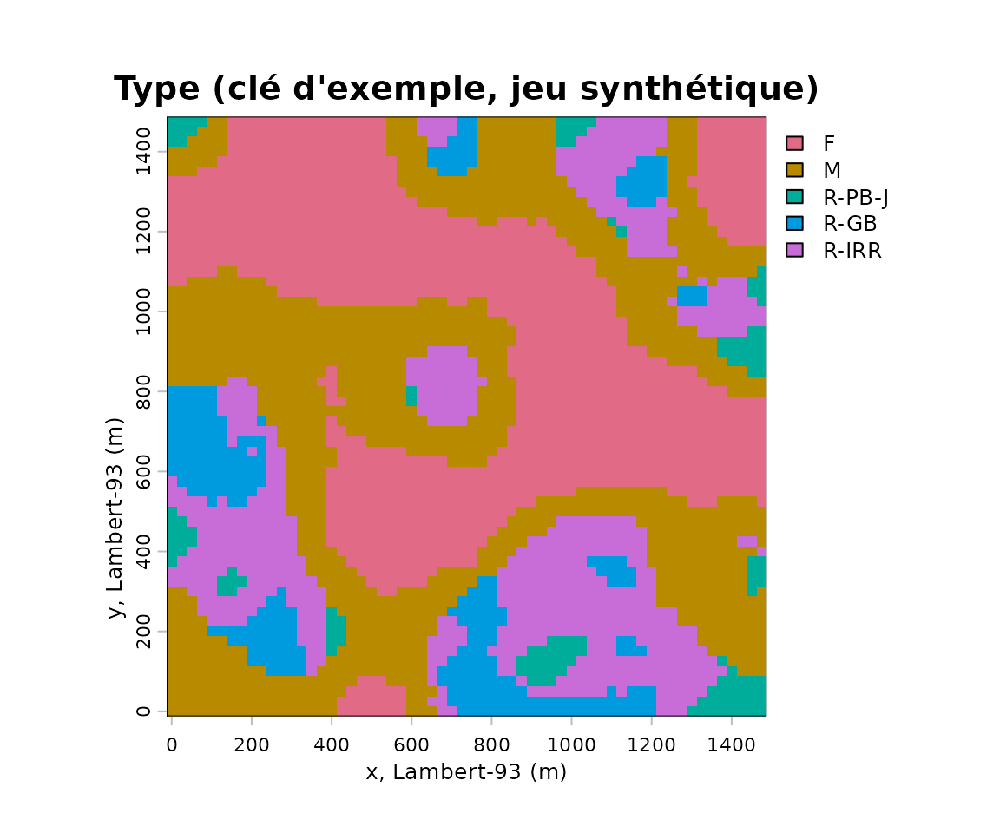
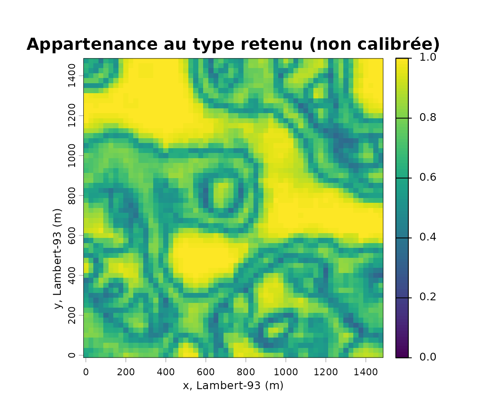
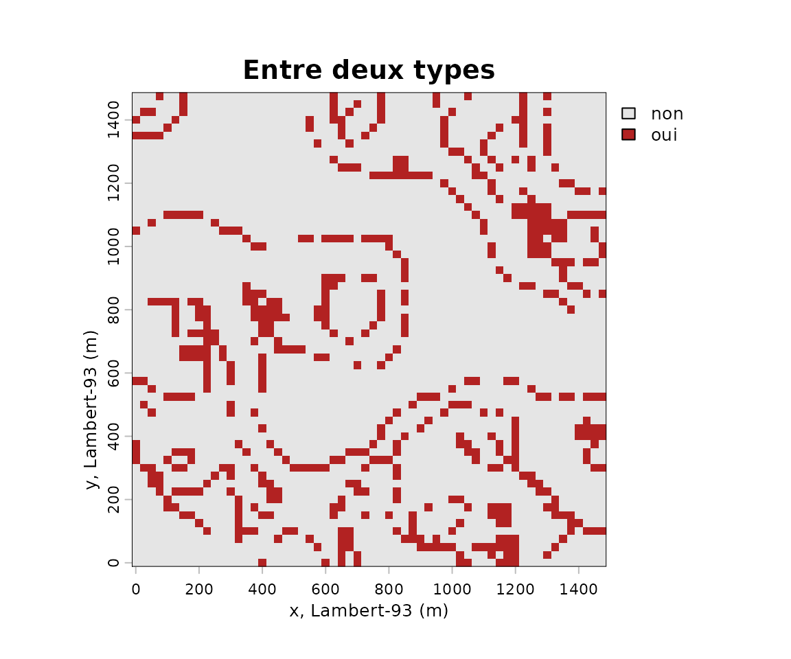

# Résultats sur l'AOI pilote

> **Pas encore de carte réelle de Léoncel.** L’AOI pilote est la forêt
> domaniale de Léoncel plus les forêts privées voisines dans la SER H10
> (Préalpes du Nord). Tant que ses livrables ne sont pas calculés, cet
> article montre la **démonstration sur jeu synthétique** : elle prouve
> que le rapport se fabrique et dit ce qu’il doit dire, elle ne décrit
> aucune forêt. Les chiffres ci-dessous ne valent rien sur données
> réelles.

## Ce que contient un rapport d’AOI

Pour une AOI déjà calculée, le pipeline (`_targets.R`) rend un rapport
Quarto :

- les **cartes des types**, une par légende présente dans les livrables
  (SRGS d’abord, puis GSM) ;
- la **couche de confiance** : appartenance au type retenu, drapeaux
  (entre deux types, hauteur potentielle incertaine, hors clé, strates
  basses estimées) ;
- un tableau **état de preuve** : pour chaque chiffre, mesuré,
  provisoire ou non vérifié ;
- une section **Limites**.

``` sh
# démonstration, sans réseau
Rscript -e 'targets::tar_make(callr_function = NULL)'
# mode réel : livrables d'une AOI déjà calculée (aucun calcul LiDAR n'est lancé)
TYPO_AOI=/chemin/livrables TYPO_TITRE="Léoncel" Rscript -e 'targets::tar_make(callr_function = NULL)'
```

## Démonstration (jeu synthétique)

``` r

dossier <- file.path(tempdir(), "livrables_demo")
res <- lancer_demo(dossier, graine = 0)
types <- terra::rast(file.path(dossier, "types.tif"))
corr <- utils::read.csv(file.path(dossier, "correspondance_types.csv"), fileEncoding = "UTF-8")
r <- types[["type"]]
levels(r) <- data.frame(valeur = corr$valeur, type = corr$code)
terra::plot(r, main = "Type (clé d'exemple, jeu synthétique)", mar = c(3.5, 5, 3.5, 7),
            xlab = "x, Lambert-93 (m)", ylab = "y, Lambert-93 (m)",
            col = grDevices::hcl.colors(nrow(corr), "Dark 3"))
```



Le nombre associé au type est une **appartenance**, non calibrée : ce
n’est pas une probabilité (arbitrage C12).

``` r

terra::plot(types[["proba"]], range = c(0, 1), mar = c(3.5, 5, 3.5, 7),
            xlab = "x, Lambert-93 (m)", ylab = "y, Lambert-93 (m)",
            main = "Appartenance au type retenu (non calibrée)")
```



Une carte de drapeau : les pixels « entre deux types », où le second
type est presque aussi plausible que le premier.

``` r

d <- terra::ifel(types[["entre_deux"]] > 0, 1, 0)
levels(d) <- data.frame(valeur = 0:1, drapeau = c("non", "oui"))
terra::plot(d, col = c("grey90", "firebrick"), mar = c(3.5, 5, 3.5, 7),
            xlab = "x, Lambert-93 (m)", ylab = "y, Lambert-93 (m)",
            main = "Entre deux types")
```



## État de preuve

``` r

knitr::kable(etat_de_preuve(dossier, demo = TRUE))
```

| chiffre | statut | commentaire |
|:---|:---|:---|
| Tous les chiffres de ce rapport | non vérifié | Jeu synthétique et clé d’exemple : démonstration du pipeline, aucune forêt réelle. |
| Validation indépendante de la carte | non vérifié | Aucune validation indépendante. La carte est produite, non validée. Aucune placette indépendante géolocalisée au pixel dans la SER H10 ; les placettes IFN, publiées au kilomètre, ne valident que des agrégats (ADR 0010). |
| Nombre de pixels, part de chaque type, part de chaque drapeau | mesuré | Comptage direct sur les rasters livrés ; ce n’est pas une exactitude. |
| Type d’un pixel | non vérifié | Sortie de la clé appliquée aux variables modélisées ; non confrontée à des relevés indépendants. |
| Appartenance au type | provisoire | Non calibrée : ce n’est pas une probabilité (arbitrage C12) ; à lire en ordre, pas en valeur. |
| Seuils de la clé (diamètre, couvert, hauteur) | provisoire | Seuils par référentiel (ADR 0007), certains encore provisoires dans la configuration. |
| Hauteur potentielle | provisoire | Modèle appris sur les adultes fermés ; H0 du jeu ONF non calibrée (fiche ONF, p. 2). |
| Précision et kappa de la fiche de validation | non vérifié | Calculés sur placettes synthétiques : sans valeur sur données réelles. |

La carte est **produite et non validée** : aucune placette indépendante
n’est géolocalisée au pixel dans la SER H10 (les placettes IFN, publiées
au kilomètre, ne valident que des agrégats), il n’y a donc aucune
validation indépendante (ADR 0006, 0010).

## Limites

``` r

cat(paste0("- ", limites_rapport(dossier, demo = TRUE)), sep = "\n")
```

- Jeu synthétique et clé d’exemple : aucune de ces cartes ne décrit une
  forêt réelle.
- La carte est une aide à la décision, pas un diagnostic : elle ne
  remplace pas la visite de terrain (typologie descriptive).
- Pas de validation indépendante : la carte est produite et non validée.
  Aucune placette indépendante géolocalisée au pixel dans la SER H10 ;
  les placettes IFN, publiées au kilomètre, ne valident que des agrégats
  (ADR 0010).
- Hors clé : 0,0 % des pixels ne correspondent à aucun type de la clé.
- Entre deux types : 15,1 % des pixels, où le second type est presque
  aussi plausible que le premier.
- Hauteur potentielle incertaine sur 0,0 % des pixels : les types qui en
  dépendent y sont moins sûrs.
- Type GSM (H10) : types de la légende absents de la carte : R-PB-C.
