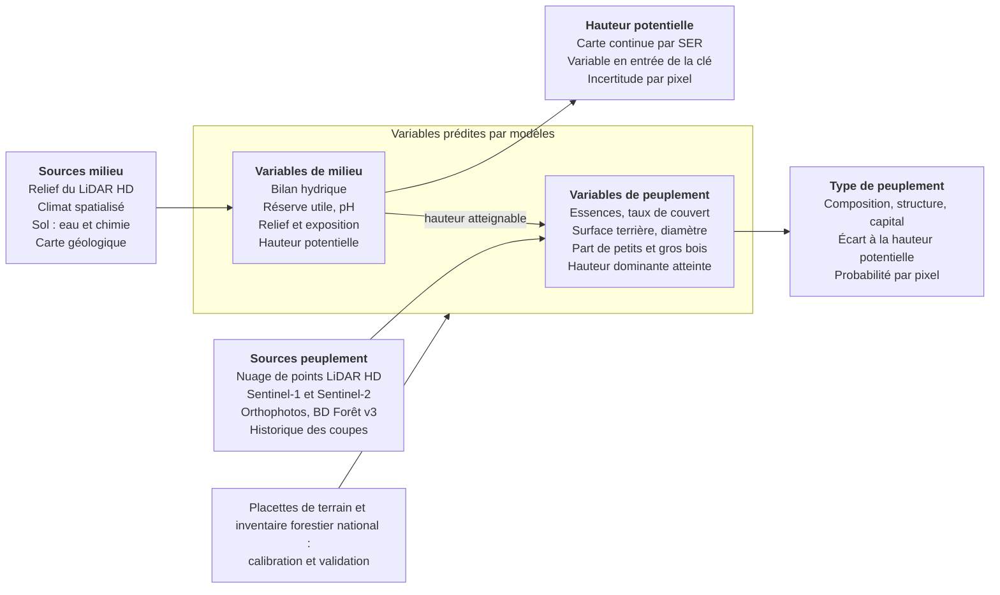

# Brief – Typologie automatique des peuplements par sylvoécorégion

21 novembre 2026 · Pascal Obstetar

## Ma réponse d'abord

« je m'en passe » — Pascal, 2026-11-22

## En bref

Le projet vise une chaîne de traitement automatique qui produit, pour toute forêt de France hexagonale, une carte du **type de peuplement** (composition, structure, capital), calibrée par sylvoécorégion (SER).

- **Point de départ.** Le mémoire de J. Souchon (ONF, 2020) atteint 76 % de bonne classification au demi-hectare en Savoie, avec le LiDAR seul et sur les seuls peuplements résineux et mixtes de montagne.
- **Ambition.** Passer d'un démonstrateur montagnard mono-source à un socle national multi-sources, décliné par SER, utilisable en forêt publique comme en forêt privée.
- **Leviers.** Imagerie satellitaire pour les essences, LiDAR HD pour la structure, données de milieu pour la hauteur potentielle. Ces dernières restent une donnée d'entrée : le projet ne produit pas de typologie de stations.
- **Décisions attendues.** Valider le périmètre, choisir deux à quatre SER pilotes, désigner le porteur du projet.

## Contexte et point de départ

Le mémoire de J. Souchon (AgroParisTech / ONF, pôle RDI de Chambéry, 2020) montre qu'une typologie générique de peuplements peut être prédite par LiDAR aérien, mais avec des limites nettes.

| Volet | Ce qui est acquis | Ce qui limite |
| --- | --- | --- |
| Données | 1 016 placettes de 15 m de rayon sur 3 massifs (Savoie, Vosges, Hautes-Pyrénées) | Vols de 2016 à 2019 à 3–5 pts/m² en Savoie, antérieurs au LiDAR HD ; 2 à 4 ans d'écart entre vol et terrain |
| Composition | 85 à 90 % de bonne prédiction feuillus / résineux / mixte, mieux qu'OSO (69–81 %) et que la BD Topo végétation (72–77 %) | Pas d'essence ; résineux sur sols superficiels classés en feuillus |
| Structure | 58 à 72 % en calibration, 76 % au demi-hectare en validation indépendante | 49 % à la placette ; confusion régulier / irrégulier ; petits bois de sous-étage mal détectés |
| Typologie | Clé générique, sans biais d'observateur, erreur connue | Feuillus décrits par le seul capital ; pas de hauteur potentielle, donc types 1, 2 et 3 du guide Alpes du Nord indistincts |
| Méthode | Triangle des structures + forêts aléatoires, reproductible sur 3 massifs | Seuils durs : environ 10 % d'erreur sur la part de gros bois fait changer de type ; jeu de calibration déséquilibré |

Deux constats du rapport orientent ce brief. La typologie de terrain relevée « à dire d'expert » n'est pas une vérité terrain fiable. Et l'auteur propose lui-même de croiser les cartes avec une carte des stations pour retrouver la hauteur potentielle.

## Objectifs et périmètre

Le projet livre des cartes prédictives et leurs clés de lecture, pas des consignes de gestion.

**Objectifs**

1. Produire une carte des **types de peuplements** qui couvre aussi les feuillus, les taillis et les mélanges futaie-taillis.
2. Passer de la famille (feuillus / résineux) à l'essence principale.
3. Situer chaque peuplement par rapport à la hauteur que le milieu permet, pour séparer peuplement jeune et peuplement chétif.
4. Afficher pour chaque pixel la probabilité du type prédit et l'erreur mesurée en validation indépendante.
5. Rendre la chaîne rejouable à chaque nouvelle donnée (image satellite annuelle, nouveau vol).

**Dans le périmètre**

- France hexagonale et Corse, forêts publiques et privées.
- Une résolution de travail de l'ordre de 25 m, une lecture à l'échelle du quart au demi-hectare.
- Une table de correspondance entre les types prédits et les typologies locales existantes (guides de sylviculture, typologies des schémas régionaux de gestion sylvicole).

**Hors périmètre**

- Le choix des essences et les itinéraires sylvicoles : la typologie reste descriptive.
- Le remplacement du diagnostic de terrain : les cartes sont une aide à la décision et un outil de stratification d'inventaire.
- L'outre-mer, dont les données et les forêts appellent un projet distinct.

## Propositions d'amélioration

Chaque limite du rapport reçoit une source complémentaire au LiDAR HD ; les trois premières lignes sont prioritaires, car elles répondent aux faiblesses que le rapport et les aménagistes consultés signalent.

| Priorité | Limite constatée | Source complémentaire | Apport attendu |
| --- | --- | --- | --- |
| 1 | Composition réduite à feuillus / résineux / mixte ; faux feuillus sur sols superficiels | Séries temporelles Sentinel-2, orthophotos infrarouges, [BD Forêt v3](https://www.data.gouv.fr/datasets/jeu-de-donnees-test-bd-foret-v3-juin-2026-beta) | Passer de la famille à l'essence, corriger par la phénologie |
| 1 | Pas de hauteur potentielle | Données de milieu : climat, sol, topographie (section suivante) | Rapporter la hauteur mesurée à la hauteur atteignable, séparer peuplement jeune et peuplement chétif |
| 1 | Confusion régulier / irrégulier, petits bois mal vus | [LiDAR HD](https://www.data.gouv.fr/datasets/nuages-de-points-lidar-hd) (au moins 10 impulsions/m²), LiDAR terrestre ou mobile sur les placettes | Décrire le sous-étage, prédire directement la part de petits bois |
| 2 | Décalage de 2 à 4 ans entre vol et terrain | Détection de changements Sentinel-2, modèles de surface photogrammétriques, historique des coupes | Écarter ou mettre à jour les zones exploitées ou sinistrées |
| 2 | Jeu de calibration déséquilibré, types terrain peu fiables | Placettes de l'inventaire forestier national, inventaires d'aménagement et de plans simples de gestion | Plus de placettes dans les types rares, échantillonnage stratifié |
| 2 | Feuillus décrits par le seul capital | Vols hors feuilles, Sentinel-1 et Sentinel-2, placettes en plaine | Étendre la clé aux taillis et aux mélanges futaie-taillis |
| 3 | État sanitaire absent | Indices de dépérissement issus de Sentinel-2 | Signaler les peuplements en crise, utile au renouvellement |

La BD Forêt v3, encore en version bêta, distingue les essences dès 0,5 ha sur 35 classes. Le rapport écartait la donnée IGN à cause de cette même maille de 0,5 ha : elle servira de variable d'entrée, pas de vérité.

**Améliorations de méthode, indépendantes des sources**

- Remplacer les seuils durs du triangle des structures par des probabilités d'appartenance, et afficher les pixels « entre deux types ».
- Ajouter un modèle de présence ou de part de petits bois, piste ouverte par le rapport.
- Abaisser le seuil de précomptage sur une partie des placettes : à 17,5 cm, les perches et la régénération échappent à la calibration.
- Valider à l'échelle de lecture réelle (grappes de placettes sur un quart à un demi-hectare), pas seulement à la placette.
- Comparer plusieurs classifieurs (forêts aléatoires, SVM, analyse discriminante), ce que le rapport n'a pas eu le temps de faire.

## Hauteur potentielle : le milieu en donnée d'entrée

Le milieu n'est pas typé : il sert à estimer, pixel par pixel, la hauteur dominante qu'un peuplement adulte peut atteindre. C'est la piste que le rapport ouvre lui-même pour distinguer les types 1, 2 et 3 du guide Alpes du Nord.

| Facteur | Variables | Sources candidates |
| --- | --- | --- |
| Topographie | Altitude, pente, exposition, position topographique, indice d'humidité, rayonnement | Modèle numérique de terrain du LiDAR HD |
| Climat | Températures, précipitations, bilan hydrique climatique | Données Météo-France spatialisées, couches Digitalis |
| Sol | Réserve utile, profondeur, pH | Couches Digitalis, référentiels pédologiques régionaux, carte géologique |
| Réponse des arbres | Hauteur dominante des peuplements adultes voisins | Hauteurs LiDAR HD |

**Démarche**

1. Repérer par LiDAR HD les peuplements adultes fermés de chaque SER et relever leur hauteur dominante.
2. Modéliser cette hauteur en fonction des variables de milieu, par essence ou famille d'essences.
3. Appliquer le modèle à toute la SER pour obtenir une carte de hauteur potentielle.
4. Introduire dans la clé des peuplements le rapport entre hauteur mesurée et hauteur potentielle.

**Point faible connu : le sol.** La carte nationale de pH de Digitalis, tirée de 104 375 placettes d'inventaire, n'explique que 58 % de la variance du pH mesuré ([description Digitalis](https://zenodo.org/records/10277365/files/Dataset%20description.pdf)). Là où le modèle reste trop incertain, la clé doit s'en tenir à la hauteur mesurée et le signaler.

**Travaux à reprendre.** Les typologies de stations existantes sont qualitatives et non harmonisées entre zones ([GIS Sol, 2018](https://gissol.hub.inrae.fr/content/download/552/5005?version=1)) ; elles servent ici de contrôle, pas d'entrée. Le dossier de [Forêt-entreprise n° 228](https://franceboisforet.fr/wp-content/uploads/2016/05/FE228-intro-dossier.pdf) (CNPF-IDF) et les travaux wallons ([Forêt.Nature n° 143](https://orbi.uliege.be/bitstream/2268/213520/1/Wampach%20F.%20et%20al._Cartographie%20de%20la%20disponibilit%c3%a9%20en%20eau_ForNat143_vulg2017.pdf)) donnent des méthodes de spatialisation du milieu. BioClimSol, outil du CNPF, croise déjà climat et sol.

## Déclinaison par sylvoécorégion

La SER est le bon niveau de déclinaison : la France hexagonale en compte 86, plus 5 d'alluvions récentes, regroupées en 11 grandes régions écologiques plus la Corse ([GeoData INRAE](https://geodata.inrae.fr/geonetwork/srv/api/records/67044273-ec7e-4487-afe7-fa5dda5fa2bd)).

**Principe : un socle national, une calibration locale**

| Niveau | Ce qui est commun | Ce qui est propre |
| --- | --- | --- |
| National | Variables d'entrée, grille, chaîne de traitement, format des livrables, protocole de placette | – |
| Grande région écologique | Modèles par défaut quand une SER manque de placettes | Familles d'essences, étages climatiques |
| SER | – | Seuils (catégories de bois, hauteur potentielle), nombre et nom des types, correspondance avec les typologies locales |

Le rapport illustre ce besoin : la limite des gros bois est fixée à 42,5 cm en Savoie et dans les Pyrénées, à 47,5 cm dans les Vosges.

**Règles de déclinaison**

- Une SER reçoit son propre modèle quand elle dispose d'assez de placettes pour chaque type ; sinon elle hérite du modèle de sa grande région. Le seuil reste à fixer en phase pilote.
- Les limites de SER ne doivent pas créer de ruptures sur la carte : prévoir une bande de transition où les deux modèles sont pondérés.
- Les 5 SER d'alluvions (vallées, peupleraies) demandent une clé à part.

**SER pilotes suggérées**

| Contexte | Pourquoi | Données déjà disponibles |
| --- | --- | --- |
| Alpes du Nord (Savoie) | Continuité avec le rapport, typologie locale connue | 751 placettes, cartes ONF |
| Vercors drômois | Partenariat public-privé déjà actif, LiDAR HD à 23 pts/m² | [Base ONF – CNPF – Département de la Drôme](https://www.data.gouv.fr/datasets/parametres-forestiers-lidar-vercors-dromois-2021-2022-1), avec couches de typologie |
| Une SER de plaine feuillue | Combler le principal angle mort du rapport | À constituer |
| Une SER à dominante privée (Massif central, par exemple) | Tester l'usage en forêt privée morcelée | À inventorier |

## Méthode et chaîne de traitement

La chaîne prédit d'abord des variables continues, puis en déduit les types ; les données de milieu n'y entrent que pour estimer la hauteur potentielle.

La flèche « hauteur atteignable » est le lien nouveau par rapport au rapport de 2020 : la hauteur potentielle tirée du milieu entre dans la clé des peuplements.

**Étapes**

1. **Socle de données.** Assembler par SER le LiDAR HD, les séries Sentinel, les couches de milieu et les placettes disponibles, sur une grille unique.
2. **Placettes.** Compléter par un échantillonnage stratifié sur une première carte, avec position des arbres, hauteurs mesurées, perches et relevé de sol.
3. **Variables.** Calculer les métriques LiDAR (nuage et couronnes), spectrales et stationnelles, puis sélectionner les plus utiles.
4. **Modèles.** Prédire les variables dendrométriques et stationnelles, puis classer en types avec une probabilité par pixel.
5. **Cartes.** Appliquer une clé par SER, lisser à l'échelle de lecture, raccorder les limites de SER.
6. **Validation.** Mesurer l'erreur sur des grappes de placettes indépendantes, par type et par SER.
7. **Mise à jour.** Rejouer la chaîne quand une coupe, un dépérissement ou un nouveau vol est détecté.

**Livrables**

- Une carte des types de peuplements par SER, avec sa couche de confiance, et la carte de hauteur potentielle en appui.
- Les cartes des variables continues, souvent plus utiles au gestionnaire que le type lui-même.
- Une clé de détermination et une table de correspondance avec les typologies locales.
- Une fiche de validation par SER : matrices de confusion, erreurs, domaine de validité.
- Le code de la chaîne et le protocole de placette, documentés.

Le rapport de 2020 utilise Computree, R et ArcGIS ; un passage à des outils libres faciliterait le partage entre organismes.

## Phasage, partenaires, risques

Le projet avance en trois phases, chacune fermée par un critère de passage ; les durées et le budget restent à chiffrer avec le porteur.

1. **Cadrage.** Inventaire des données par SER, choix des pilotes, protocole de placette commun, gouvernance. *Passage : pilotes et porteur désignés, accès aux données acquis.*
2. **Pilotes.** Chaîne complète sur deux à quatre SER contrastées, validation indépendante, retours de gestionnaires. *Passage : précision au demi-hectare au moins égale aux 76 % du rapport, y compris en feuillus, et cartes jugées utilisables sur le terrain.*
3. **Généralisation.** Extension par grande région écologique, puis affinage SER par SER selon les placettes disponibles. *Passage : fiche de validation publiée pour chaque SER couverte.*

**Partenaires pressentis**

| Organisme | Apport |
| --- | --- |
| IGN | LiDAR HD, BD Forêt v3, placettes de l'inventaire forestier national, découpage en SER |
| ONF (pôle RDI) | Chaîne de traitement LiDAR existante, placettes et typologie du rapport de 2020 |
| CNPF et son institut de développement | Forêt privée, typologies des schémas régionaux, BioClimSol, relais vers les plans simples de gestion |
| INRAE, AgroParisTech | Couches de milieu (Digitalis), méthodes, validation scientifique |
| Coopératives et experts forestiers | Données d'inventaire, tests en conditions réelles |

**Risques**

| Risque | Parade |
| --- | --- |
| Données de sol trop grossières pour estimer la hauteur potentielle | Relevés de sol dans les pilotes ; à défaut, s'en tenir à la hauteur mesurée et le signaler |
| Trop peu de placettes dans les types rares | Échantillonnage stratifié ; modèle de la grande région par défaut |
| LiDAR HD acquis à des dates et saisons différentes selon les blocs | Date et saison du vol en variable ; mise à jour par imagerie |
| Données fines sensibles en forêt privée | Résolution dégradée en diffusion publique, comme dans le Vercors drômois |
| Carte prise pour une vérité | Couche de confiance obligatoire, formation des utilisateurs |

**Questions ouvertes**

- [ ] Faut-il une clé nationale unique déclinée par seuils, ou des clés distinctes par SER ?
- [ ] Qui porte le projet, et dans quel cadre de financement ?
- [ ] Quelles SER pilotes, et avec quelles placettes existantes ?
- [ ] La typologie doit-elle être reconnue par les schémas régionaux de gestion sylvicole pour servir dans les plans simples de gestion ?
- [ ] Le code de la chaîne ONF est-il partageable entre organismes ?

## Sources

- J. Souchon, *Prédiction d'une typologie forestière à partir de données LiDAR dans un contexte montagnard*, mémoire AgroParisTech / ONF, 2020.
- [Jeu de données test BD Forêt v3](https://www.data.gouv.fr/datasets/jeu-de-donnees-test-bd-foret-v3-juin-2026-beta), IGN, data.gouv.fr.
- [Nuages de points LiDAR HD](https://www.data.gouv.fr/datasets/nuages-de-points-lidar-hd), IGN, data.gouv.fr.
- [Paramètres forestiers LiDAR – Vercors drômois 2021-2022](https://www.data.gouv.fr/datasets/parametres-forestiers-lidar-vercors-dromois-2021-2022-1), ONF, CNPF Auvergne-Rhône-Alpes, Département de la Drôme.
- [SylvoEcoRégions](https://geodata.inrae.fr/geonetwork/srv/api/records/67044273-ec7e-4487-afe7-fa5dda5fa2bd), GeoData INRAE.
- [Description des couches Digitalis](https://zenodo.org/records/10277365/files/Dataset%20description.pdf), Zenodo.
- [Utilisation des données stationnelles en forêt](https://gissol.hub.inrae.fr/content/download/552/5005?version=1), GIS Sol, 2018.
- [Forêt-entreprise n° 228, dossier stations forestières](https://franceboisforet.fr/wp-content/uploads/2016/05/FE228-intro-dossier.pdf), CNPF-IDF.
- [Cartographie de la disponibilité en eau et en éléments nutritifs des stations forestières de Wallonie](https://orbi.uliege.be/bitstream/2268/213520/1/Wampach%20F.%20et%20al._Cartographie%20de%20la%20disponibilit%c3%a9%20en%20eau_ForNat143_vulg2017.pdf), Forêt.Nature n° 143, 2017.

Ces sources ont été consultées par leurs résumés en ligne ; les chiffres sont à revérifier dans les documents complets avant diffusion.
